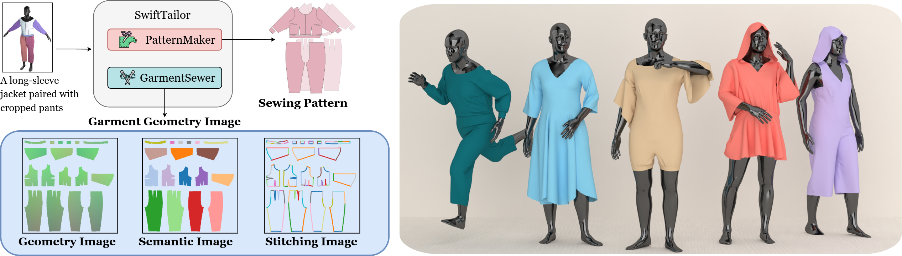

<div align="center">

# SwiftTailor: Efficient 3D Garment Generation with Geometry Image Representation

<a href="https://openaccess.thecvf.com/content/CVPR2026/html/Pham_SwiftTailor_Efficient_3D_Garment_Generation_with_Geometry_Image_Representation_CVPR_2026_paper.html"></a> &ensp;
<a href="https://qualcomm-ai-research.github.io/SwiftTailor/"></a> &ensp;
<a href="https://openaccess.thecvf.com/content/CVPR2026/html/Pham_SwiftTailor_Efficient_3D_Garment_Generation_with_Geometry_Image_Representation_CVPR_2026_paper.html"></a> &ensp;

</div>

**Official PyTorch implementation** of our CVPR 2026 paper:
["**SwiftTailor: Efficient 3D Garment Generation with Geometry Image Representation**"](https://openaccess.thecvf.com/content/CVPR2026/html/Pham_SwiftTailor_Efficient_3D_Garment_Generation_with_Geometry_Image_Representation_CVPR_2026_paper.html)

Author List:
[Phuc Pham](https://scholar.google.com/citations?user=csPUj7kAAAAJ&hl=en),
[Uy Dieu Tran](https://scholar.google.com/citations?hl=vi&user=OpPFGrIAAAAJ),
[Binh-Son Hua](https://scholar.google.com/citations?hl=vi&user=sV_VjsAAAAAJ),
[Phong Nguyen](https://scholar.google.com/citations?hl=vi&user=030WAOoAAAAJ)



We introduce ***SwiftTailor***, a two-stage framework designed to generate high-quality sewing patterns and reconstruct garments in 3D. The system consists of **PatternMaker**, which predicts structured sewing patterns from input representations, and **GarmentSewer**, which assembles these patterns into complete garment geometries. In addition, we propose a novel garment geometry image representation that enables efficient and direct decoding into final 3D garment meshes. This design allows us to directly generate 3D garment meshes without requiring a simulation engine, making the generation process more efficient. *The generated meshes are also simulation-ready and can be utilized in downstream tasks*.

## 📖 Introduction
SwiftTailor is a two-stage framework that turns an image, text prompt, or both into a
sewn, stitched 3D garment mesh:

1. **PatternMaker** — a vision-language model (InternVL3-2B vision encoder + Qwen2 LLM
   backbone) that generates a 2D sewing pattern from the user input.
2. **GarmentSewer** — a Dense Prediction Transformer (DPT) that synthesizes a Garment
   Geometry Image (GIM) in a unified UV space from the sewing pattern, then reconstructs a
   3D garment mesh via remeshing and dynamic stitching.


## 🏁 Getting Started

Clone the repository:

```bash
git clone https://github.com/Qualcomm-AI-research/SwiftTailor.git
cd SwiftTailor
```

Then follow the installation guide below.

## ⚙️ Installation Instructions

See [`INSTALL.md`](INSTALL.md) for the complete, step-by-step guide — conda environment,
PyTorch, NVIDIA Warp fork, GarmentCode/PyGarment, the SwiftTailor package, optional
PyTorch3D, and downloading the model weights and evaluation data.

Model weights are distributed via [GitHub Releases](https://github.com/Qualcomm-AI-research/SwiftTailor/releases/tag/v1.0.0)
and fetched by `bash scripts/download_weights.sh` (see [Step 6 in `INSTALL.md`](INSTALL.md#step-6-download-weights-and-data)).

## 📁 Repository Structure

```
SwiftTailor/
├── src/swifttailor/        # core package
│   ├── patternmaker/       # Stage 1: VLM sewing-pattern generator (InternVL3 + Qwen2)
│   ├── garmentsewer/       # Stage 2: DPT geometry-image synthesis
│   │   └── gim/            # UV unwarping, conditioning bridge, remeshing/stitching
│   ├── data/               # datasets, garment tokenizers, pattern wrappers
│   └── config.py           # GLOBAL_CONFIG — repo-root-relative paths
├── configs/                # configuration, organized by stage
│   ├── patternmaker/       # PatternMaker Hydra config tree
│   ├── garmentsewer/       # GarmentSewer model config (dpt_v16.yaml)
│   ├── garmentcode/        # vendored GarmentCode sim/render props
├── scripts/                # entry points + download helpers
│   ├── run_patternmaker.py # Stage 1: PatternMaker eval harness (DeepSpeed, benchmark test-set only)
│   ├── run_patternmaker_generate.py # Stage 1: PatternMaker inference (your text/image → pattern)
│   ├── run_garmentsewer.py # Stage 2: GarmentSewer reconstruction (pattern → mesh)
│   ├── run_e2e.py          # end-to-end: text/image → pattern → mesh
│   ├── run_garmentcode.py  # GarmentCode cloth simulation given a sewing pattern
│   ├── benchmark/          # test-set benchmark (Stage A + Stage B reproduce Table 2 in paper)
│   └── download_weights.sh
├── weights/                # downloaded model weights (not in repo)
├── data/                   # downloaded evaluation data (not in repo)
│   └── test_set/           # check INSTALL.md for test_set folder structure
├── INSTALL.md
└── requirements.txt
```

## 🚀 Usage

**PatternMaker** — generate a sewing pattern from your own image / text:

```bash
export PYTHONPATH=$PYTHONPATH:$(pwd)/src
# image -> pattern
python scripts/run_patternmaker_generate.py input_image=assets/dress.png
# text -> pattern
python scripts/run_patternmaker_generate.py input_text="a long-sleeve jacket"
# image + text -> pattern
python scripts/run_patternmaker_generate.py input_image=assets/dress.png input_text="sleeveless top and skirt"
```

Sewing patterns are written to `output/patternmaker_generate/<name>/`.

**GarmentSewer** — reconstruct a 3D mesh from an existing sewing pattern:

```bash
export PYTHONPATH=$PYTHONPATH:$(pwd)/src
python scripts/run_garmentsewer.py --spec path/to/<id>_specification.json
# or run over a directory of PatternMaker outputs:
python scripts/run_garmentsewer.py --input output/patternmaker --output-dir output/pipeline
```

**End-to-end pipeline** — text / image → 3D mesh (runs both stages):

```bash
export PYTHONPATH=$PYTHONPATH:$(pwd)/src
export PYTHONPATH=$PYTHONPATH:$(pwd)/GarmentCode 

# image → mesh
python scripts/run_e2e.py input_image=assets/dress.png
# text → mesh
python scripts/run_e2e.py input_text="a long-sleeve jacket"
# image + text → mesh
python scripts/run_e2e.py input_image=assets/dress.png input_text="sleeveless top and skirt"
```

`run_e2e.py` runs PatternMaker (text/image → sewing pattern) then GarmentSewer
(pattern → mesh) in one process. Sewing patterns are written to
`output/e2e/patternmaker/` and the reconstructed meshes to `output/e2e/mesh/`.

## 📊 Benchmarking

Reproduce the paper's test-set numbers — Table 2 in the paper (Chamfer MMD-CD / COV-CD) over the 500-sample
split in [`configs/testset_500samples_full_pipeline.txt`](configs/testset_500samples_full_pipeline.txt).
The benchmark runs in two stages:

- **Stage A** — [`scripts/benchmark/gen_patternmaker_testset.py`](scripts/benchmark/gen_patternmaker_testset.py):
  PatternMaker (image + text) over each sample, with `convert_to_3d=True` to drape every
  generated pattern into a mesh via the GarmentCode simulate-until-success loop.
- **Stage B** — [`scripts/benchmark/gen_garmentsewer_testset.py`](scripts/benchmark/gen_garmentsewer_testset.py):
  GarmentSewer reconstruction over the Stage-A patterns, then set-level Chamfer metrics
  of both the GarmentCode and GarmentSewer meshes against the ground-truth meshes.

> **Note:** the Stage-B metrics need [PyTorch3D](https://github.com/facebookresearch/pytorch3d),
> which is not in `requirements.txt` — install it via the optional step in
> [`INSTALL.md`](INSTALL.md#step-3-install-python-dependencies), or pass
> `--skip-metrics` to `gen_garmentsewer_testset.py` to skip the comparison.

Set `REPO` inside the script first. Runtime behavior is controlled by
environment variables (defaults in parentheses):

```bash
export PYTHONPATH=$PYTHONPATH:$(pwd)/src
export PYTHONPATH=$PYTHONPATH:$(pwd)/GarmentCode 

CONDA_ENV=swifttailor NSHARDS=2 \
    bash scripts/benchmark/run_bench_1gpu.sh
```

### Reproduced results

Results reproduced using the command above on an H100 GPU (MMD-CD may fluctuate within a small margin across different hardware platforms):

| Reconstruction | MMD-CD ↓ | COV-CD ↑ |
| --- | --- | --- |
| PatternMaker + GarmentCode | 6.89 | 0.53 |
| PatternMaker + GarmentSewer | 5.49 | 0.68 |

## 🔧 Troubleshooting

Common installation and runtime issues are covered in the
[Troubleshooting table in `INSTALL.md`](INSTALL.md#troubleshooting). A few highlights:

| Issue | Solution |
|-------|----------|
| `nvcc` not found | Install the CUDA Toolkit or set `export CUDA_PATH=/path/to/cuda` |
| `ModuleNotFoundError: pygarment` | See INSTALL.md, Step 4 |
| `flash_attn` build error | Optional — PatternMaker falls back to standard attention |
| `numpy<2` conflict | GarmentCode requires `numpy<2`; this is pinned in `requirements.txt` |

## 📚 Citation

If you find SwiftTailor useful in your research, please cite:

```bibtex
@InProceedings{Pham_2026_CVPR,
    author    = {Pham, Phuc and Tran, Uy Dieu and Hua, Binh-Son and Nguyen, Phong},
    title     = {SwiftTailor: Efficient 3D Garment Generation with Geometry Image Representation},
    booktitle = {Proceedings of the IEEE/CVF Conference on Computer Vision and Pattern Recognition (CVPR)},
    month     = {June},
    year      = {2026},
    pages     = {27169-27178}
}
```

## 📄 License

This repository is licensed under the [BSD-3-Clause-Clear License](https://spdx.org/licenses/BSD-3-Clause-Clear.html). See [LICENSE](LICENSE) for the full license text.